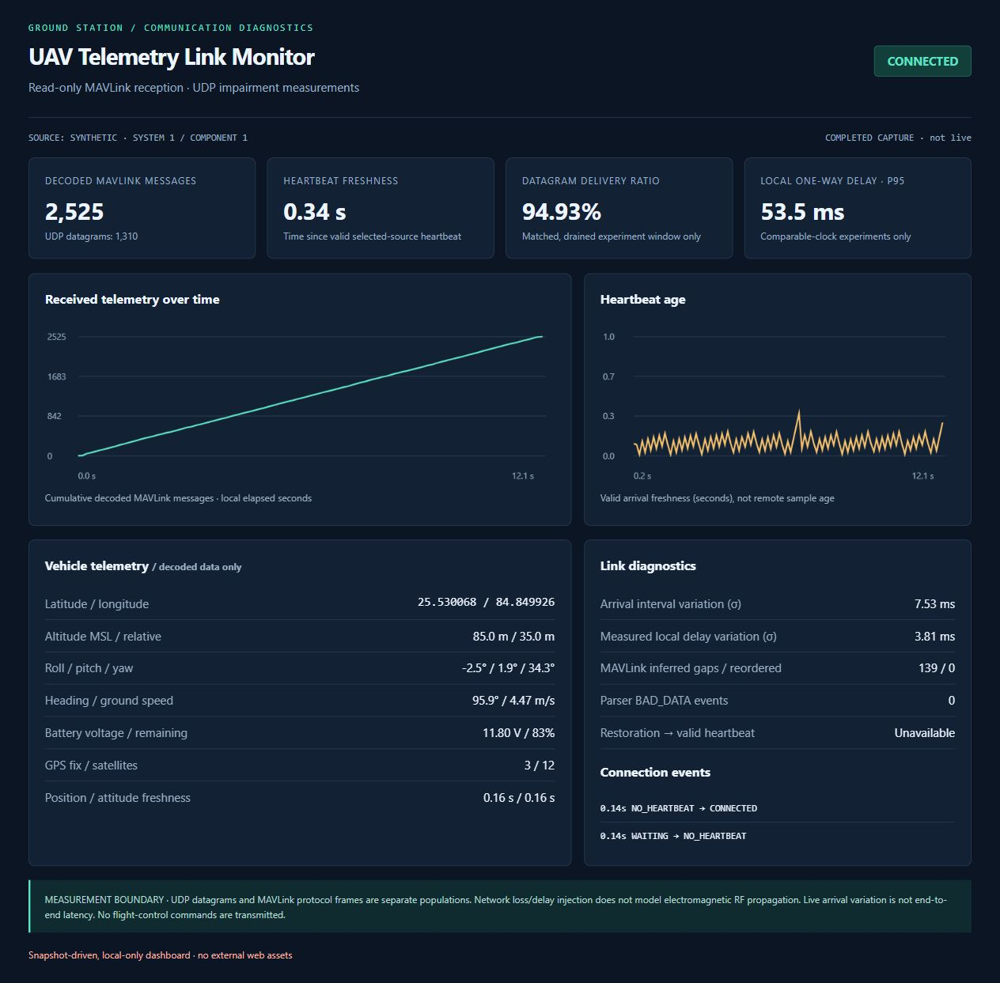
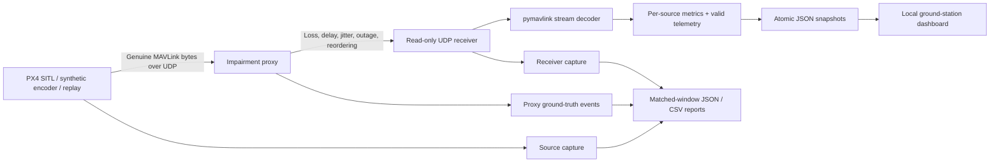
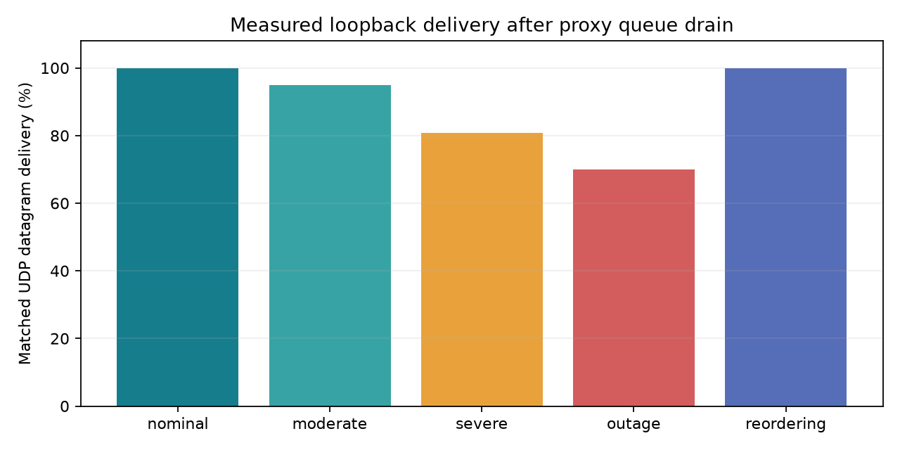
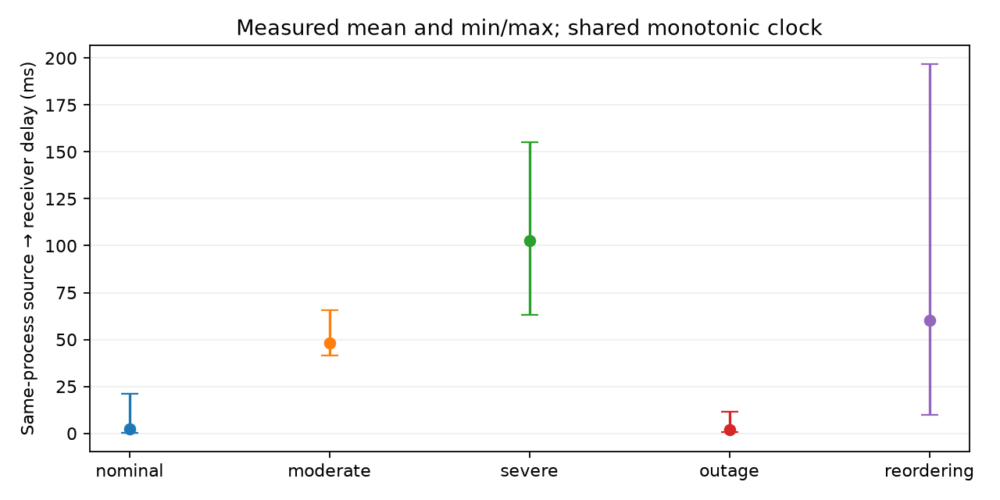
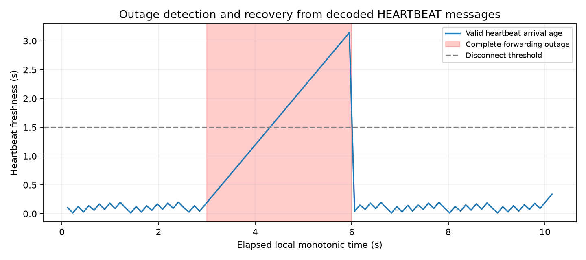
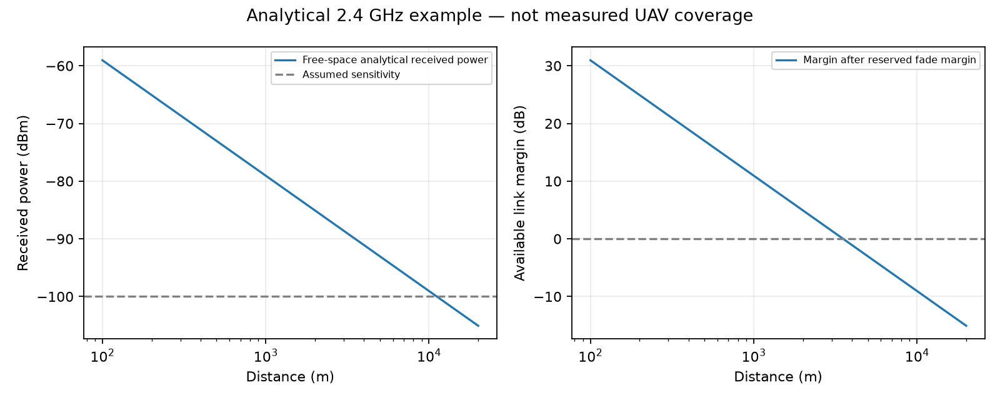

# UAV Telemetry Link Monitor

**A read-only MAVLink communication monitor with real UDP transport, controlled network impairments and auditable reliability measurements.**

[](https://github.com/Afifah48/uav-telemetry-link-monitor/actions/workflows/tests.yml)


The source encodes genuine MAVLink 2 frames with `pymavlink`, sends them over UDP, and passes them through a separate loss/delay/outage proxy. The receiver decodes the bytes, validates telemetry, tracks each sender and measures heartbeat freshness. A local dashboard displays the received data and connection history. An offline replay mode runs without PX4 or any aircraft.

Built by [Afifah Khan](https://github.com/Afifah48) as an aerospace communication-engineering prototype. **Network impairment is simulated; UDP transport and MAVLink parsing are actually executed.** This is not physical RF testing or flight-control software.

> The implementation is on `feature/telemetry-monitor` for pull-request review. It is not merged into the default branch without approval. PX4 SITL integration is documented but **unverified** in the development environment.



The screenshot comes from the completed 12-second synthetic UDP run saved in [`results/demo/`](results/demo/), with 1,310 received datagrams and 2,525 decoded messages. It explicitly labels the completed capture; its values are not a currently connected aircraft. A separate [live-reception screenshot](docs/images/dashboard-live.png) shows the dashboard while traffic was arriving. Unmeasurable live PDR/one-way latency fields stay **Unavailable**.

## System architecture



No arming, setpoints, parameter writes or flight commands are implemented. The receiver has no vehicle-bound send path. PX4 output-stream setup, when used, is done explicitly in the simulator shell.

## Quick start — no PX4 required

Python **3.11+**. Clone the implementation branch while the PR is under review:

```bash
git clone --branch feature/telemetry-monitor https://github.com/Afifah48/uav-telemetry-link-monitor.git
cd uav-telemetry-link-monitor
python -m venv .venv
source .venv/bin/activate
# Windows PowerShell: .\.venv\Scripts\Activate.ps1
python -m pip install -e ".[dev]"
python -m pytest -q
telemetry-monitor demo --config configs/degraded.yaml --duration 30 --output results/demo --port 8765
```

While the last command runs, open **[http://127.0.0.1:8765](http://127.0.0.1:8765)**. It launches the actual synthetic encoder, UDP proxy, receiver, metrics engine and dashboard. It uses automatically allocated loopback UDP ports to avoid collisions; the report records their actual endpoints. The config's fixed endpoints are used by the separate-process workflow below. The command finishes after the finite capture, drains pending traffic, and saves its measured report.

To reopen a completed capture:

```bash
telemetry-monitor dashboard --snapshot results/demo/snapshot.json --report results/demo/report.json --port 8765
```

The dashboard uses Python's standard-library HTTP server and a bundled HTML/Canvas interface. It has no external runtime assets, cloud account, map service or Streamlit installation requirement. It is bound to loopback and exposes read-only HTTP endpoints.

## Start each component independently

Run these in separate terminals from the project root, starting the receiver and proxy before the source:

```bash
# Terminal 1: receive and decode only
telemetry-monitor receive --config configs/baseline.yaml --mode synthetic --duration 0 --snapshot results/live/snapshot.json --output results/live

# Terminal 2: configurable impairment proxy
telemetry-monitor proxy --config configs/degraded.yaml --duration 0 --output results/live

# Terminal 3: genuine synthetic MAVLink traffic, default destination 127.0.0.1:14600
telemetry-monitor source --endpoint 127.0.0.1:14600 --duration 60 --output results/live

# Terminal 4: monitor received values; PDR/remote latency are unavailable without a matched report
telemetry-monitor dashboard --snapshot results/live/snapshot.json --port 8765
```

Duration zero means continuous operation for receiver/proxy; stop them with Ctrl+C. Controlled demos/experiments require a positive finite duration. A separate-process verification script executes the same production CLI modules and checks their real UDP counts:

```bash
python scripts/verify_processes.py --output results/process-check
```

The checked-in run verified **92 sent → 92 forwarded → 92 received datagrams**, **178 decoded MAVLink messages**, and **zero BAD_DATA events**.

### Replay genuine captured bytes

Start the receiver/proxy as above, selecting `--mode replay` on the receiver, then:

```bash
telemetry-monitor replay --input experiments/example_capture.jsonl --endpoint 127.0.0.1:14600 --speed 1
# A completed experiment's source or receiver capture also works:
telemetry-monitor replay --input results/experiments/nominal/receiver.jsonl --endpoint 127.0.0.1:14600 --speed 2
```

Replay preserves byte content and relative capture timing, scaled by `--speed`. Both source and receiver capture formats are tested. Binary `.tlog` import is not implemented; the project uses its documented JSONL/base64 datagram capture format.

## MAVLink reception and displayed fields

| Message | Received fields used |
|---|---|
| HEARTBEAT | System/component identity, state, heartbeat age and reconnection |
| GLOBAL_POSITION_INT | Latitude/longitude, MSL/relative altitude, heading, horizontal speed |
| ATTITUDE | Roll, pitch and yaw, converted from radians to degrees |
| SYS_STATUS | Battery millivolts → volts, current, remaining percentage; unavailable sentinels honored |
| GPS_RAW_INT | GPS fix type, satellite count, vehicle-provided timestamp |
| VFR_HUD | Ground speed and heading, when emitted |
| Other common-dialect messages | Decoded and counted by type; not substituted for missing telemetry |

The decoder handles multiple frames in a datagram and frames split across consecutive datagrams. Separate parser state is maintained per UDP peer, and sequence state per peer/system/component. NaN attitude, invalid coordinates, invalid heading and unknown battery fields are not presented as valid values. Missing message types stay unavailable; they are not automatically counted as lost packets.

Vehicle timestamps are retained with their original field names. They are **not** assumed synchronized to the host clock. Telemetry freshness means time since a valid local arrival, not remote sample age.

## Metric definitions

| Metric | Definition and availability |
|---|---|
| Datagram PDR | Matched receiver datagrams / proxy-ingress datagrams for the same finite, drained experiment population |
| Intentional UDP loss | Explicit proxy drop events, separated into random loss, outage, queued-outage and overflow reasons |
| MAVLink gap estimate | Modulo-256 per-source sequence inference with a bounded reorder window; not datagram PDR |
| Local one-way delay | Source-send → receiver-arrival using a shared monotonic clock and unambiguous payload matching in the controlled experiment |
| Proxy residence | Actual proxy ingress → forwarding interval; includes scheduling overhead |
| Delay variation | Standard deviation of matched local one-way delays, when available |
| Arrival variation | Standard deviation of received UDP inter-arrival intervals; **not** network latency/jitter |
| Heartbeat/telemetry freshness | Monotonic age of the last valid selected-source message of that type |
| Outage recovery | Restoration → first valid selected-source HEARTBEAT arrival; detected disconnection is reported separately |

Sequence wrap and out-of-order arrivals are handled without immediately converting every forward gap into permanent loss. Late arrivals repair pending gaps inside the configured window. Long gaps, sender restarts and modulo ambiguity remain limitations. The outage experiment deliberately demonstrates why independent proxy truth is required: the receiver resets its sequence epoch after inactivity rather than claiming it can reconstruct a long missing sequence interval.

See [the measurement model](docs/measurement-model.md) for exact population matching, timing conventions, FIFO holdback and identifiability limits. A UDP datagram, MAVLink message and physical RF packet are three different measurement layers.

## Run the five reliability experiments

```bash
telemetry-monitor experiments --config configs/baseline.yaml --output results/experiments
```

Each scenario runs for ten seconds using seed 48 and 100 source ticks/s. The source emits **2,220 MAVLink messages in 1,150 UDP datagrams per scenario**. All values below were measured through the real source→proxy→receiver path, not generated for the dashboard.

| Scenario | Configured datagram impairment | Received / ingress | Datagram PDR | Decoded messages | Local delay mean / p95 |
|---|---|---:|---:|---:|---:|
| Nominal | No intentional loss or delay | 1,150 / 1,150 | 100.00% | 2,220 | 2.37 / 7.83 ms |
| Moderate | 5% Bernoulli loss, 40 ms delay | 1,091 / 1,150 | 94.87% | 2,103 | 48.28 / 54.44 ms |
| Severe | 20% loss, 80 ±35 ms requested delay, FIFO order | 929 / 1,150 | 80.78% | 1,793 | 102.61 / 126.15 ms |
| Temporary outage | Forwarding interrupted from 3 to 6 seconds | 805 / 1,150 | 70.00% | 1,554 | 2.15 / 7.67 ms |
| Reordering | 15 ±10 ms delay; 25% receive 150 ms extra delay | 1,150 / 1,150 | 100.00% | 2,220 | 60.10 / 180.23 ms |

Configured Bernoulli loss is a probability, not an exact quota. The observed random-drop counts were **59/1,150 (5.13%)** and **221/1,150 (19.22%)**, consistent with finite-sample variation around 5% and 20%. A dedicated 10,000-datagram scheduler test checks repeatability and statistical expectations. The nominal sample does not certify zero loss under arbitrary load.

The outage produced a detected disconnection and a first-valid-heartbeat recovery of **18.4 ms after restoration** in this run. This small value depends on the synthetic heartbeat phase and host scheduling, and is not a guaranteed response time. Reordering produced **429 reversed-order datagram departures and 830 out-of-order MAVLink frames**; all datagrams arrived and the final inferred missing-frame count was zero.





### Saved evidence

Each scenario directory contains:

- `report.json`: exact configuration, actual endpoints, counts, clock/population definitions, delay statistics, sequence estimates and recovery result.
- `datagrams.csv`: per-ingress ID/digest, schedule delay, drop reason, forwarding time and matched arrival.
- `source.jsonl`: genuine encoded bytes and source send events, suitable for replay.
- `proxy.jsonl`: independent input/drop/forward events with monotonic and UTC timestamps.
- `receiver.jsonl`: received bytes, decoded-message counts and arrival events, also replayable.
- `snapshot.json`: decoded telemetry, state, freshness and bounded chart history.

[`summary.json`](results/experiments/summary.json) aggregates all five runs. Random decisions repeat for a fixed ingress order/seed; OS timing and outage-boundary counts can vary. A same-process clock makes the local experiment's one-way measurement meaningful; the live PX4 path leaves remote latency unavailable.

## Configuration

Use [`configs/baseline.yaml`](configs/baseline.yaml), [`configs/degraded.yaml`](configs/degraded.yaml) or [`configs/px4.yaml`](configs/px4.yaml). Unknown keys, invalid probabilities, negative/nonfinite durations and invalid IDs are rejected.

| Setting | Default / meaning |
|---|---|
| `proxy_bind` / `receiver_bind` | 127.0.0.1:14600 / 127.0.0.1:14601 in standalone mode |
| `loss_probability` | 0; Bernoulli drop probability per UDP ingress datagram |
| `delay_ms` / `jitter_ms` | 0 / 0; base delay and uniform half-width |
| `allow_reordering` | false; FIFO due-time holdback preserves order |
| `reorder_probability` / `reorder_extra_ms` | 0 / 150; optional additional datagram delay |
| `outage_start_s` / `outage_duration_s` | 3 / 0; [start, end) forwarding interruption |
| `heartbeat_warn_s` / `heartbeat_timeout_s` | 0.8 / 1.5 |
| `inactivity_timeout_s` | 2.0; selected-source silence threshold |
| `sequence_window` / `sequence_reset_s` | 64 messages / 2 seconds |
| `target_system` / `target_component` | 1 / 1; selected vehicle telemetry |
| `source_rate_hz` / `duration_s` | 100 source ticks/s / 10 seconds |
| `seed` / `max_pending` | 48 / 10,000 scheduled datagrams |
| `source_mode` | synthetic, replay or px4; explicit display provenance |

State transitions are WAITING → NO_HEARTBEAT/CONNECTED → DEGRADED/DISCONNECTED, with reconnection when a valid selected-source heartbeat returns. Inactivity timers run even when no packets arrive.

## PX4 SITL status

**Not executed here.** No PX4/Gazebo installation or available WSL distribution was present. The [PX4 integration guide](docs/px4-sitl.md) explains how to start a supported `gz_x500` vehicle, inspect `mavlink status`, configure a dedicated UDP output, and run the opt-in receive test. It cites current official PX4/MAVLink documentation rather than assuming a fixed port.

The offline synthetic/replay functionality is verified independently of SITL. Do not describe PX4 integration as validated until the documented live test has actually passed on a simulator host.

## Separate analytical RF module

```bash
telemetry-monitor rf --output results/rf
```

$$L_{FS}=20\log_{10}\left(\frac{4\pi df}{c}\right),\qquad
P_r=P_t+G_t+G_r-L_{FS}-L_{other}.$$

Distance is in metres, frequency in hertz, power in dBm and gains/losses in dB. Raw margin is received power minus assumed sensitivity; available margin additionally subtracts a reserved fade margin. Parameters are configurable through the `LinkBudget` Python API:

```python
from pathlib import Path
from uav_telemetry.rf_analysis.budget import LinkBudget, generate
generate(Path("results/custom-rf"), LinkBudget(
    frequency_hz=915e6, transmit_dbm=20, transmit_gain_dbi=2,
    receive_gain_dbi=2, sensitivity_dbm=-100, other_losses_db=3, fade_margin_db=10))
```



This free-space calculation is independent of the UDP experiments. It does not infer radio coverage, antenna performance or flight-link reliability from loopback data.

## Verification and CI

**48 tests passed, zero failed, one optional PX4 test skipped** on local Python 3.13.5. Statement coverage is approximately **86%**; [raw coverage data](results/coverage.json) and [JUnit results](results/tests.xml) are included. Plotting is executed by the experiment suite; it is not included in unit-test coverage. Coverage is a reporting measure, not a substitute for test quality.

```bash
python -m pytest -q --cov=uav_telemetry --cov-report=term-missing
python scripts/verify_processes.py --output results/process-check
python -m pip check
```

Tests cover genuine framing/CRC rejection and stream resynchronization, datagram aggregation/fragmentation, heartbeat loss/reconnection, per-source isolation, unavailable/sentinel telemetry, deterministic loss, wrapping/reordering, real UDP forwarding, matched-window metrics, replay of source/receiver captures, sustained traffic, dashboard APIs, Windows snapshot retries, persistent display-write failure isolation and invalid configurations.

GitHub Actions runs tests on Python 3.11/3.13, a short full-scenario smoke run, RF output generation and separate-process verification. Check the linked workflow for hosted status. The local wheel was also built and its bundled dashboard asset verified. See [validation notes](docs/validation.md) for executed commands and limitations.

## Project layout

```text
src/uav_telemetry/
  transport/      # read-only UDP receiver and framing integration
  mavlink/        # pymavlink codec, synthetic encoder and replay
  impairments/    # loss/delay/outage/reorder scheduler and UDP proxy
  metrics/        # sequence inference, freshness, telemetry and connection state
  dashboard/      # local HTTP service and bundled HTML/Canvas UI
  rf_analysis/    # independent free-space link budget
  utils/          # validated configuration and structured event logs
configs/          # nominal, degraded and PX4 examples
experiments/      # replayable genuine-frame fixture
scripts/          # suite and separate-process verification
tests/            # unit, UDP integration and opt-in PX4 tests
results/          # measured JSON/CSV/JSONL artifacts and plots
docs/             # measurement model, PX4 setup, validation and screenshots
```

## Engineering limits and next steps

- Controlled loss acts on UDP datagrams; no RF fading, propagation, MAC retries, radio bandwidth limit or flight hardware is simulated.
- PX4 integration is unverified. Synthetic coordinates/status are test stimuli, not a flight-dynamics model or real vehicle measurements.
- Common-dialect MAVLink and IPv4 UDP only; no custom dialect, signing configuration, `.tlog` import or authenticated source assurance.
- Sequence inference cannot resolve arbitrary counter resets, ≥128-message gaps or unlimited reordering. Ground truth is taken from proxy events instead.
- Local timing includes Python, logging and OS scheduling overhead. Remote one-way latency requires clock synchronization and an explicit correlation mechanism.
- Captures consume disk; in-memory datagram matching and histories are bounded. The prototype needs log rotation and streaming correlation for long deployments.
- No automated flight actions are triggered by link-health state. Dashboard file errors are isolated from reception, but production supervision and richer fault handling remain future work.

Useful next steps include executing the PX4 SITL test on a documented Linux setup, validating with recorded vehicle traffic, adding authenticated MAVLink, streaming long-duration analysis and comparing telemetry behavior with measured radio-link statistics.

[Three resume bullets grounded in measured work](docs/resume.md) · [MIT license](LICENSE)

## Protocol references

- [MAVLink framing and sequence fields](https://mavlink.io/en/guide/serialization.html)
- [Official pymavlink usage guide](https://mavlink.io/en/mavgen_python/)
- [MAVLink common message definitions and units](https://mavlink.io/en/messages/common.html)
- [PX4 simulation endpoints](https://docs.px4.io/main/en/simulation/)
- [PX4 MAVLink module options](https://docs.px4.io/main/en/modules/modules_communication.html#mavlink)
